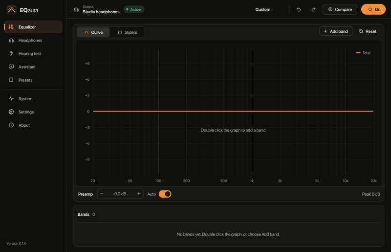
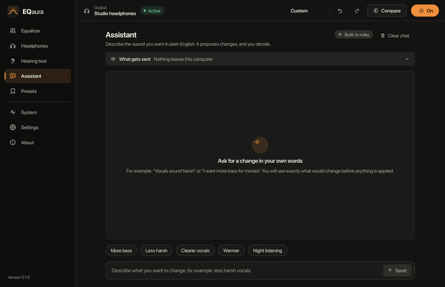
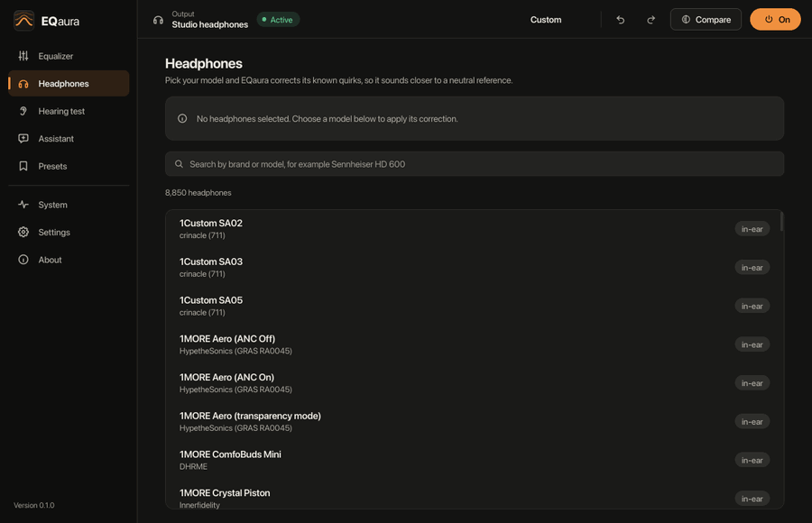
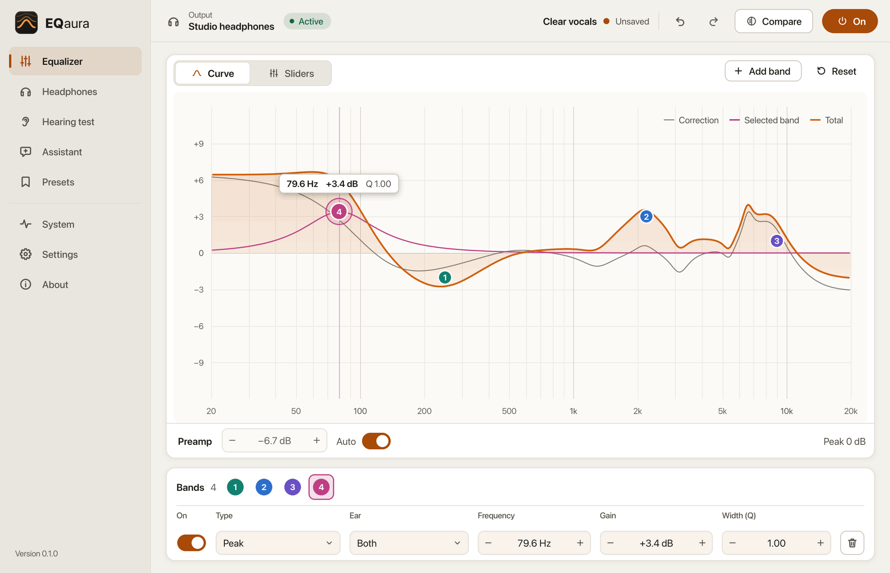
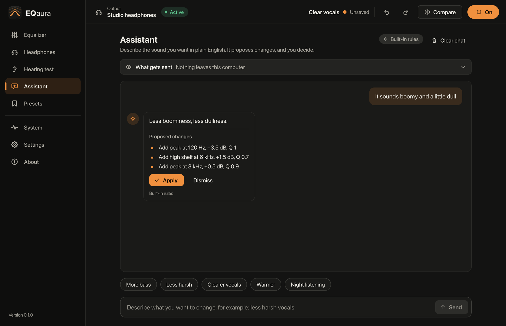
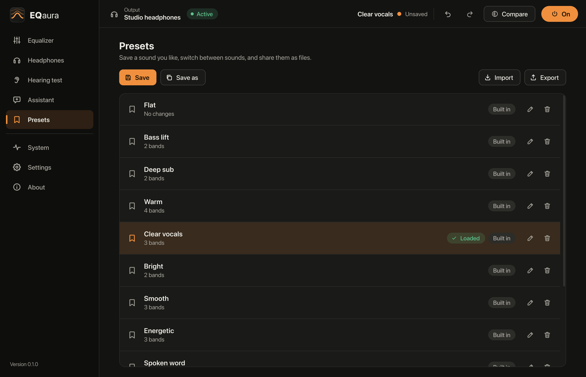
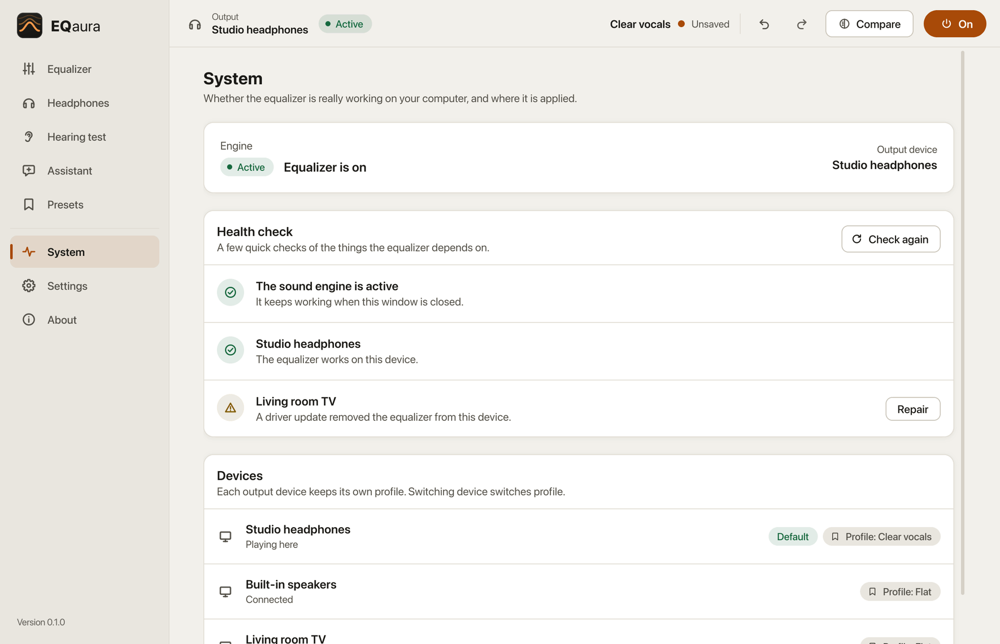
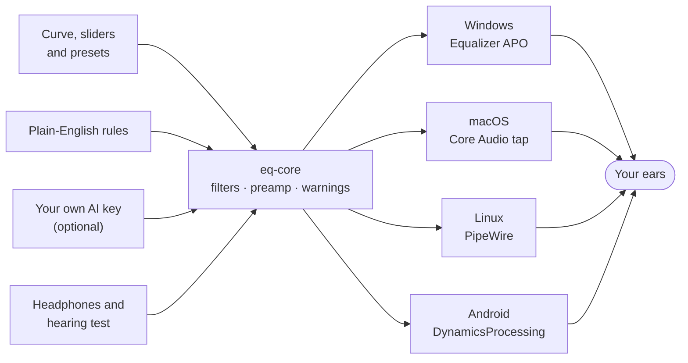

<div align="center">


# EQaura

**Shape the sound of everything you play.**

A free, open-source, system-wide equalizer for Windows, macOS, Linux and Android, written in Rust.<br>
Drag a curve, pick your headphones, or just say what you want to hear.

[](https://github.com/AdityaTummuri/EQaura/actions/workflows/build.yml)
[](https://github.com/AdityaTummuri/EQaura/actions/workflows/android.yml)
[](LICENSE)




[Download](#download) · [Features](#features) · [How it works](#how-it-works) · [Build it](#build-from-source) · [Help](#when-something-does-not-work)

</div>

## Features

- **One curve for every app.** Music, films, games and calls all go through the same equalizer.
- **As many bands as you like.** Peak, shelf, pass and notch filters, for both ears or just one. There is a ten-slider view when you want something simpler.
- **What you see is what you hear.** The graph and the audio engine use the same maths, checked to a fraction of a decibel on every build.
- **8,850 headphone corrections** from the [AutoEq](https://github.com/jaakkopasanen/AutoEq) project, built in and available offline.
- **A hearing test for each ear**, turned into gentle compensation you can dial up or down.
- **Plain-English tuning.** "More bass, less harsh" works with no account and no internet. Add your own API key for Anthropic, any OpenAI-compatible service, or a local Ollama model if you want more.
- **Advice instead of limits.** EQaura warns you about distortion and loudness, but the decision stays yours. Auto preamp keeps boosts from clipping.
- **A sound for every device.** Headphones, speakers and the TV each keep their own settings and switch by themselves.
- **Made to be trusted.** Full undo, A/B compare at matched volume, no telemetry, no account.

### Say what you want to hear



Every suggestion is shown first. Nothing changes until you press Apply, and one undo takes it back.

### Correct your headphones



### Light and dark

| | |
| :---: | :---: |
|  |  |
|  |  |

## Download

Get the newest build from the [Releases page](https://github.com/AdityaTummuri/EQaura/releases). If there is no release yet, open the latest green run under [Actions](https://github.com/AdityaTummuri/EQaura/actions/workflows/build.yml) and take the file for your system from *Artifacts*, or [build it yourself](#build-from-source).

<details open>
<summary><b>Windows 10 and 11 (64-bit)</b></summary>

1. Run `EQaura-…-windows-x64-setup.exe`. Windows asks once for administrator rights.
2. If you do not have [Equalizer APO](https://sourceforge.net/projects/equalizerapo/) yet, setup installs it and opens its device list. Tick every device you listen on and confirm.
3. Start EQaura. If nothing changes, restart Windows once.

The installer is not signed, so SmartScreen may say it is from an unknown publisher. Choose *More info*, then *Run anyway*, or check the file against its `.sha256` first.

Already using Equalizer APO? Your settings stay. EQaura adds one `Include:` line and tells you if other settings are active.
</details>

<details>
<summary><b>macOS 14.2 or newer (Apple silicon and Intel)</b></summary>

1. Open the `.dmg` and drag EQaura to Applications.
2. The app is not notarized. The first time, right-click it and choose *Open*, or allow it under *System Settings › Privacy & Security*.
3. Play something. macOS asks to let EQaura capture system audio. That is how it can equalize it; nothing is recorded.

No driver or kernel extension is installed.
</details>

<details>
<summary><b>Linux with PipeWire 1.0 or newer</b></summary>

- **Ubuntu, Debian:** `sudo apt install ./EQaura-…-linux-amd64.deb`
- **Fedora, openSUSE:** `sudo dnf install ./EQaura-…-linux-x86_64.rpm`
- **Others:** unpack the `.tar.xz` into `~/.local`

The equalizer runs as a small user service inside PipeWire and keeps working when the app is closed. With WirePlumber 0.5 or newer it follows your output device on its own.
</details>

<details>
<summary><b>Android 9 or newer</b></summary>

1. Install the `.apk` for your processor: `arm64-v8a` for almost every phone, `armeabi-v7a` for old ones. Android asks you to allow installing from your browser or file manager. The Android builds are under [android](https://github.com/AdityaTummuri/EQaura/actions/workflows/android.yml) in Actions until there is a release.
2. Open EQaura and choose *Turn on*. No root is needed.
3. If nothing changes, switch *Settings › Coverage* to *Per app*, and turn off other equalizers such as the phone's own or Dolby.

A small notification keeps the equalizer running. It comes back by itself after a restart.
</details>

## How it works

EQaura does the maths and hands the result to the best engine each system has.



| | Engine | If EQaura crashes |
| --- | --- | --- |
| **Windows** | Equalizer APO reads a settings file that EQaura writes | Sound goes on, equalized |
| **macOS** | A separate small process filters a system audio tap | The window can crash freely. If the engine stops, macOS plays the sound unchanged |
| **Linux** | Native PipeWire biquads with coefficients from EQaura, updated live | Sound goes on, equalized |
| **Android** | Android's own DynamicsProcessing effect, with the curve mapped to about 100 bands | Sound goes on unchanged until Android restarts the service |

On macOS the engine listens first and only takes over once it really receives sound, so a missing permission never leaves you in silence.

## Privacy

- No account, no telemetry, no server. Settings are plain JSON files on your computer.
- The assistant's built-in rules run offline. A request to an AI provider goes out only when you press send, straight from your computer to the provider you chose. *What gets sent* shows the exact text.
- API keys live in Windows Credential Manager, the macOS Keychain or your Linux keyring, or encrypted with the Android Keystore, travel only over HTTPS (or to your own machine), and are never written to logs or settings.

## Build from source

You need [Rust](https://rustup.rs) 1.92 or newer. On Linux also `libasound2-dev libfontconfig1-dev libxkbcommon-dev`.

```sh
git clone https://github.com/AdityaTummuri/EQaura
cd EQaura
cargo run --release -p eqaura
```

Try the interface without touching your sound:

```sh
EQAURA_DEMO=1 EQAURA_HOME=/tmp/eqaura cargo run --release -p eqaura
```

The Android app is in `apps/android`. It needs the Android SDK and NDK, [cargo-ndk](https://github.com/bbqsrc/cargo-ndk), JDK 17 and Gradle 8.14:

```sh
cargo ndk --platform 28 -t arm64-v8a -o apps/android/app/src/main/jniLibs build --release -p eq-ffi
cd apps/android && gradle assembleDebug
```

Installers come from `installer/` and are built for every push by [GitHub Actions](.github/workflows/build.yml).

<details>
<summary><b>Project layout</b></summary>

```text
crates/
  eq-core/      filters, curves, presets, warnings, rules, hearing test, headphone data
  eq-ai/        optional AI providers and strict answer checking
  eq-store/     settings, presets, API keys
  eq-backend/   Equalizer APO, PipeWire and Core Audio
  eq-ffi/       the core for Android, and the curve as Android's bands
apps/
  desktop/      the app (Slint interface in ui/, logic in src/)
  agent-win/    small Windows tray helper
  android/      the Android app (Kotlin and Jetpack Compose)
installer/      Windows, macOS and Linux packages
tools/          headphone data packer, license list, PipeWire and Android measurements
```
</details>

<details>
<summary><b>What is tested</b></summary>

- Filter responses against an independent analogue reference, within 0.01 dB.
- Processed audio against the drawn curve, within 0.02 dB.
- 10,000 random profiles: with Auto preamp the total curve never rises above 0 dB at any frequency.
- 10,000 broken AI answers: none can produce a broken filter, and no API key ever reaches a log or message.
- The macOS audio callback with unusual channel layouts, live setting changes and a real-time budget.
- The generated Linux settings inside a real PipeWire, measured from a recording.
- The whole desktop app, driven without a window on all three systems.
- The Android app on virtual phones from Android 9 to 16: tones played through the real effect and measured against the curve, every page used, and a restart.
- The size of every download, and the memory of the open window.

```sh
cargo test --workspace
```
</details>

## When something does not work

Open the **System** page first. It checks the engine and your devices and offers a repair where one exists.

| Problem | What to do |
| --- | --- |
| **Windows:** no change in sound | On the System page choose *Set up* or *Repair* next to your device, tick it in the list and restart |
| **Windows:** stopped after an update | A driver update can unhook Equalizer APO. Choose *Repair*. The tray helper (Settings › Start at login) tells you when this happens |
| **macOS:** "Waiting for sound" while music plays | Allow EQaura under *System Settings › Privacy & Security › Screen & System Audio Recording* |
| **macOS:** asks for permission again after an update | Expected, because the app is not signed with a paid certificate |
| **Linux:** switching outputs skips the equalizer | On WirePlumber 0.4 keep EQaura open while switching, or pick *EQaura* as the output |
| **Android:** no change in sound | Open *More › System status*. Try *Per app* coverage, and turn off other equalizers |
| **Android:** stops after a while | Exclude EQaura from battery optimization. *System status* opens the right page |
| Sound is quieter than before | Auto preamp makes room for boosts. Use smaller boosts or turn it off and watch the warning |

Still stuck? Use *Settings › Save diagnostics* and [open an issue](https://github.com/AdityaTummuri/EQaura/issues).

The hearing test is not a medical test. Start at a low volume. Loud sound can damage your hearing.

## Credits

[Slint](https://slint.dev) for the interface (Royalty-free License 2.0) · [AutoEq](https://github.com/jaakkopasanen/AutoEq) by Jaakko Pasanen (MIT) and the people who measured the headphones · [Equalizer APO](https://sourceforge.net/projects/equalizerapo/) by Jonas Thedering (GPL-2.0, a separate program) · [PipeWire](https://pipewire.org) · [Jetpack Compose](https://developer.android.com/compose) (Apache-2.0) · Robert Bristow-Johnson's Audio EQ Cookbook.

<a href="https://madewithslint.com"></a>

## License

[MIT](LICENSE). Contributions are welcome.
